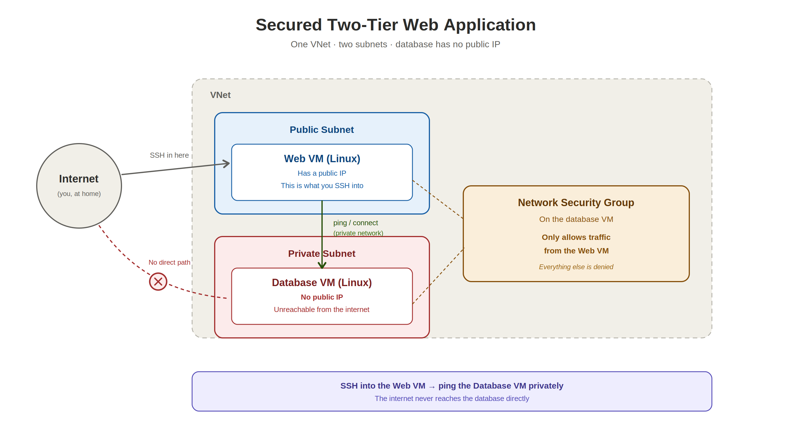

# Lab 02 — Secured Two-Tier Web Application

Deploying a classic IaaS architecture in Azure: a public web tier and a private database tier, separated by subnets and locked down with Network Security Groups so the database is reachable only from the web server, never directly from the internet.


## 🎥 Watch Me Live
[Watch me build this lab live →](https://www.loom.com/share/056b4ac77e834bb88f891b78e413fd84)

## Overview

| Field | Value |
|---|---|
| Time to complete | 60 minutes |
| Difficulty | Beginner |
| Tools used | Azure Portal, Azure Virtual Network, Network Security Groups |
| Career relevance | Cloud Networking, Azure Administrator, Network Security fundamentals |

## The Concept This Lab Introduces

This is the network segmentation pattern behind almost every production web application: a public-facing tier that the internet can reach, and a private tier (usually a database) that should never be directly exposed, no matter how good its own security is. If the database has no public IP and only accepts traffic from the web subnet, then even a fully compromised internet connection can't reach it directly, an attacker would first have to compromise the web server itself.

This lab builds that separation from scratch: two subnets inside one VNet, a web server with a public IP, a database server with none, and a Network Security Group rule that explicitly allows traffic only from the web subnet's IP range.

## Architecture



## Lab Variables

| Setting | Value |
|---|---|
| Resource Group | `rg-lab02-[yourname]` |
| VNet Name | `vnet-lab02` |
| Subnet 1 (Public) | `snet-web` — 10.0.1.0/24 |
| Subnet 2 (Private) | `snet-db` — 10.0.2.0/24 |
| Web VM | `vm-web-01` |
| Database VM | `vm-db-01` |

## What I Built

- A VNet (`10.0.0.0/16`) with two subnets: a public web subnet and a private database subnet
- A web server (`vm-web-01`) in the public subnet, with a public IP and SSH/HTTP access
- A database server (`vm-db-01`) in the private subnet, with **no public IP at all**
- Verified connectivity between the two tiers over the private network using a jump-through-the-web-server pattern
- Locked down the database's Network Security Group so only traffic from the web subnet's IP range (`10.0.1.0/24`) is allowed in

## Skills Demonstrated

| Skill | Real-world application |
|---|---|
| Designing a VNet with public and private subnets | The foundational pattern behind nearly every production web architecture |
| Deploying VMs into specific subnets | Placement determines exposure, this is the actual security boundary, not just an organizational label |
| Omitting a public IP intentionally | The single most effective way to protect a backend resource is to make it unreachable from the internet in the first place |
| Using a jump host pattern to reach private resources | The standard way ops teams access backend systems that have no direct external access |
| Writing Network Security Group rules scoped to a CIDR range | Least-privilege networking, allowing only the specific source that legitimately needs access |

## Step-by-Step Setup

### Phase 1 — The network foundation
1. Search **Virtual Networks** → **+ Create**
2. Resource Group: create new, `rg-lab02-[yourname]` · Name: `vnet-lab02` · Region: East US
3. IP Addresses: address space `10.0.0.0/16`, with two subnets:
   - `snet-web` → `10.0.1.0/24`
   - `snet-db` → `10.0.2.0/24`
4. **Review + create** → **Create**

### Phase 2 — Deploying the web server
5. Search **Virtual Machines** → **+ Create**
6. Resource Group: `rg-lab02-[yourname]` · Name: `vm-web-01` · Region: East US
7. Image: Ubuntu Server 20.04 LTS · Size: Standard_B1s · Key pair: `key-lab02`
8. Public inbound ports: allow **HTTP (80)** and **SSH (22)**
9. Networking: subnet `snet-web`, Public IP: **Create New (Standard)**
10. **Review + create** → **Create**, and download the private key (`.pem`) if prompted

### Phase 3 — Deploying the database server
11. Create another VM: Resource Group `rg-lab02-[yourname]` · Name `vm-db-01` · Region East US
12. Image: Ubuntu Server 20.04 LTS · Size: Standard_B1s · Key pair: use existing `key-lab02`
13. Public inbound ports: allow **SSH (22)** only
14. **Networking, this is the critical step:** Virtual Network `vnet-lab02`, Subnet changed to `snet-db`, Public IP set to **None**
15. **Review + create** → **Create**

### Phase 4 — Validating connectivity (the "jump")
Since `vm-db-01` has no public IP, it can't be reached directly from a home computer. Connect to the web server first, then jump to the database server.

16. Get `vm-db-01`'s private IP from its resource page (should be `10.0.2.4`)
17. SSH into the web server using its public IP:
    ```bash
    ssh -i key-lab02.pem azureuser@[public-ip-of-web]
    ```
18. From inside the web server, test connectivity to the database:
    ```bash
    ping 10.0.2.4
    ```
    Replies confirm both servers are connected inside the VNet. `Ctrl + C` to stop.

### Phase 5 — Locking down the firewall (NSG)
At this point, `vm-db-01` is technically reachable from anywhere inside the VNet, not just the web subnet. This step scopes it down explicitly.

19. Go to the **Networking** tab of `vm-db-01`, click its Network Security Group
20. **Inbound security rules** → **+ Add**
21. Create the rule:

| Field | Value |
|---|---|
| Source | IP Addresses |
| Source IP addresses/CIDR ranges | `10.0.1.0/24` (the web subnet) |
| Source port ranges | `*` |
| Destination | Any |
| Service | Custom |
| Destination port ranges | `*` (or `3306`/`5432` if a real database were installed) |
| Action | Allow |
| Priority | 100 |
| Name | `Allow-Web-Subnet` |

22. Click **Add**

> Since `vm-db-01` has no public IP, internet traffic was already blocked by default. This rule explicitly documents and enforces that only the web subnet is allowed to reach it, rather than relying on the absence of a public IP alone.

## Troubleshooting

| Issue | Fix |
|---|---|
| Ping fails | Confirm `vm-db-01` was deployed into `snet-db` specifically, and that both VMs are in the same VNet |
| Can't SSH into `vm-db-01` | Expected, there's no public IP. You must SSH into `vm-web-01` first. (Copying the `.pem` key onto the web server to jump directly from there is a more advanced pattern for later) |

## Terraform Deployment (Infrastructure as Code Version)

Everything in Phases 1 through 3 above can be deployed with Terraform instead of the portal, same VNet, same two subnets, same web and database VMs, just reproducible and version-controlled. The NSG rule from Phase 5 is included here too, scoped to the web subnet's CIDR range exactly as configured manually.

The actual `.tf` files for this deployment are in this repo. Folder structure:

```
azure-two-tier-web-app-lab/
├── main.tf              ← VNet, both subnets, both VMs, NSG and its rule
├── variables.tf          ← input variables
├── outputs.tf            ← public IP of the web VM, private IP of the DB VM
└── terraform.tfvars.example
```

### `main.tf`

```hcl
terraform {
  required_providers {
    azurerm = {
      source  = "hashicorp/azurerm"
      version = "~> 3.0"
    }
  }
}

provider "azurerm" {
  features {}
}

resource "azurerm_resource_group" "main" {
  name     = var.resource_group_name
  location = var.location
}

resource "azurerm_virtual_network" "main" {
  name                = "vnet-lab02"
  address_space       = ["10.0.0.0/16"]
  location            = var.location
  resource_group_name = azurerm_resource_group.main.name
}

resource "azurerm_subnet" "web" {
  name                 = "snet-web"
  resource_group_name  = azurerm_resource_group.main.name
  virtual_network_name = azurerm_virtual_network.main.name
  address_prefixes     = ["10.0.1.0/24"]
}

resource "azurerm_subnet" "db" {
  name                 = "snet-db"
  resource_group_name  = azurerm_resource_group.main.name
  virtual_network_name = azurerm_virtual_network.main.name
  address_prefixes     = ["10.0.2.0/24"]
}

# Web tier — public IP, HTTP + SSH allowed
resource "azurerm_public_ip" "web" {
  name                = "pip-vm-web-01"
  location            = var.location
  resource_group_name = azurerm_resource_group.main.name
  allocation_method   = "Static"
  sku                 = "Standard"
}

resource "azurerm_network_security_group" "web" {
  name                = "nsg-web"
  location            = var.location
  resource_group_name = azurerm_resource_group.main.name

  security_rule {
    name                       = "AllowSSH"
    priority                   = 100
    direction                  = "Inbound"
    access                     = "Allow"
    protocol                   = "Tcp"
    source_port_range          = "*"
    destination_port_range     = "22"
    source_address_prefix      = "*"
    destination_address_prefix = "*"
  }

  security_rule {
    name                       = "AllowHTTP"
    priority                   = 110
    direction                  = "Inbound"
    access                     = "Allow"
    protocol                   = "Tcp"
    source_port_range          = "*"
    destination_port_range     = "80"
    source_address_prefix      = "*"
    destination_address_prefix = "*"
  }
}

resource "azurerm_network_interface" "web" {
  name                = "nic-vm-web-01"
  location            = var.location
  resource_group_name = azurerm_resource_group.main.name

  ip_configuration {
    name                          = "internal"
    subnet_id                     = azurerm_subnet.web.id
    private_ip_address_allocation = "Dynamic"
    public_ip_address_id          = azurerm_public_ip.web.id
  }
}

resource "azurerm_network_interface_security_group_association" "web" {
  network_interface_id     = azurerm_network_interface.web.id
  network_security_group_id = azurerm_network_security_group.web.id
}

resource "azurerm_linux_virtual_machine" "web" {
  name                            = "vm-web-01"
  location                        = var.location
  resource_group_name             = azurerm_resource_group.main.name
  size                            = "Standard_B1s"
  admin_username                  = var.admin_username
  network_interface_ids           = [azurerm_network_interface.web.id]
  disable_password_authentication = true

  admin_ssh_key {
    username   = var.admin_username
    public_key = file(var.ssh_public_key_path)
  }

  os_disk {
    caching              = "ReadWrite"
    storage_account_type = "Standard_LRS"
  }

  source_image_reference {
    publisher = "Canonical"
    offer     = "0001-com-ubuntu-server-focal"
    sku       = "20_04-lts"
    version   = "latest"
  }
}

# Database tier — NO public IP, SSH only, and only from the web subnet
resource "azurerm_network_security_group" "db" {
  name                = "nsg-db"
  location            = var.location
  resource_group_name = azurerm_resource_group.main.name

  security_rule {
    name                       = "Allow-Web-Subnet"
    priority                   = 100
    direction                  = "Inbound"
    access                     = "Allow"
    protocol                   = "Tcp"
    source_port_range          = "*"
    destination_port_range     = "*"
    source_address_prefix      = "10.0.1.0/24"
    destination_address_prefix = "*"
  }
}

resource "azurerm_network_interface" "db" {
  name                = "nic-vm-db-01"
  location            = var.location
  resource_group_name = azurerm_resource_group.main.name

  ip_configuration {
    name                          = "internal"
    subnet_id                     = azurerm_subnet.db.id
    private_ip_address_allocation = "Dynamic"
    # No public_ip_address_id — this VM is intentionally unreachable from the internet
  }
}

resource "azurerm_network_interface_security_group_association" "db" {
  network_interface_id     = azurerm_network_interface.db.id
  network_security_group_id = azurerm_network_security_group.db.id
}

resource "azurerm_linux_virtual_machine" "db" {
  name                            = "vm-db-01"
  location                        = var.location
  resource_group_name             = azurerm_resource_group.main.name
  size                            = "Standard_B1s"
  admin_username                  = var.admin_username
  network_interface_ids           = [azurerm_network_interface.db.id]
  disable_password_authentication = true

  admin_ssh_key {
    username   = var.admin_username
    public_key = file(var.ssh_public_key_path)
  }

  os_disk {
    caching              = "ReadWrite"
    storage_account_type = "Standard_LRS"
  }

  source_image_reference {
    publisher = "Canonical"
    offer     = "0001-com-ubuntu-server-focal"
    sku       = "20_04-lts"
    version   = "latest"
  }
}
```

### `variables.tf`

```hcl
variable "resource_group_name" {
  type    = string
  default = "rg-lab02-yourname"
}

variable "location" {
  type    = string
  default = "East US"
}

variable "admin_username" {
  type    = string
  default = "azureuser"
}

variable "ssh_public_key_path" {
  description = "Path to your public SSH key, e.g. ~/.ssh/id_rsa.pub"
  type        = string
  default     = "~/.ssh/id_rsa.pub"
}
```

### `terraform.tfvars.example`

```hcl
resource_group_name  = "rg-lab02-yourname"
location              = "East US"
admin_username        = "azureuser"
ssh_public_key_path   = "~/.ssh/id_rsa.pub"
```

### `outputs.tf`

```hcl
output "web_public_ip" {
  description = "Public IP of vm-web-01 — SSH in here first."
  value       = azurerm_public_ip.web.ip_address
}

output "db_private_ip" {
  description = "Private IP of vm-db-01 — reachable only from inside the VNet."
  value       = azurerm_network_interface.db.private_ip_address
}
```

### Deploy

```bash
az login
terraform init
terraform plan
terraform apply
```

Expect 12 resources to add: the resource group, VNet, 2 subnets, 2 NSGs with their rules, 2 NICs, 2 NSG/NIC associations, the public IP, and both VMs.

```bash
terraform output web_public_ip
terraform output db_private_ip
```

Use those the same way as in Phase 4 above: SSH into the web VM with the public IP, then `ping` the DB VM's private IP from inside that session to confirm the same connectivity, with the same NSG lockdown already applied as part of `main.tf` rather than a manual post-deploy step.

### Terraform teardown

```bash
terraform destroy
```

## Clean Up (Manual Portal Deployment)

If you deployed through the portal steps instead of Terraform:

```
Delete rg-lab02-[yourname]
```

## Related Labs

- **Lab 01** — Hosting a Static Website in Azure
